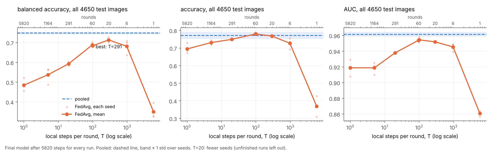

# Federated Learning on FLamby: Results Summary

How much does FedAvg lose against pooled training, and how does that depend on how often the hospitals communicate? Tested on two FLamby datasets: Fed-Heart-Disease (tabular, 4 hospitals) and Fed-ISIC2019 (skin lesion images, 6 hospitals).

## Contents

1. [Setup and notation](#setup-and-notation)
2. [What the FLamby paper did vs what I did](#what-the-flamby-paper-did-vs-what-i-did)
3. [Heart disease: communication rounds don't matter](#heart-disease-communication-rounds-dont-matter)
4. [Heart disease: which patients each hospital gets wrong](#heart-disease-which-patients-each-hospital-gets-wrong)
5. [ISIC: communication rounds matter a lot](#isic-communication-rounds-matter-a-lot)
6. [Communication cost](#communication-cost)
7. [Which hospitals lose out](#which-hospitals-lose-out)
8. [Longer training on ISIC (40 epochs)](#longer-training-on-isic-40-epochs)
9. [Compute](#compute)
10. [Takeaways](#takeaways)
11. [Open questions and next steps](#open-questions-and-next-steps)

---

## Setup and notation

| | Fed-Heart-Disease | Fed-ISIC2019 |
|---|---|---|
| hospitals | 4 | 6 |
| data | 740 patients, 13 features, binary label | ~23k dermoscopy images, 8 classes |
| model | logistic regression (14 parameters) | EfficientNet-b0, ImageNet-pretrained (~4M parameters) |
| optimizer | SGD, lr 0.003 | Adam, lr 5e-4 |
| budget | 20 pooled epochs = 2440 SGD steps | 20 pooled epochs = 5820 steps |
| seeds | 5 | 3 |

Methods compared:

- **pooled**: one model trained on all hospitals' data in one place (the upper bound FL is trying to match)
- **local**: each hospital trains alone on its own data, then keeps and uses that model itself (scored only on its own test set). Single-round FedAvg is different: the hospitals also train alone, but the server averages their four models into one shared model.
- **FedAvg**: each hospital trains locally for **K steps**, the server averages the weights, repeat

**K** is local steps per round. Every run takes the same number of SGD steps as pooled, so the number of communication rounds is `budget / K`. K = 1 averages after every step; K = budget is a single round where each hospital trains alone and the server averages once at the end. (The figure files and some result tables still label K as "T", from before the rename.)

Every result reports three metrics, since accuracy alone hides a model that leans toward the common class:

- **accuracy**
- **balanced accuracy**: mean recall over classes (FLamby's metric for ISIC)
- **AUC**

Differences between methods come with 95% paired bootstrap intervals over the test patients/images.

---

## What the FLamby paper did vs what I did

FLamby (Ogier du Terrail et al., NeurIPS 2022 Datasets and Benchmarks) introduced these datasets and benchmarked a set of FL strategies against pooled and local training.

| | FLamby benchmark | This project |
|---|---|---|
| strategies | FedAvg, FedProx, SCAFFOLD, Cyclic, FedAdam, FedYogi, FedAdagrad | FedAvg only, studied in depth |
| local steps per round | fixed at 100 | swept from 1 step to a single round (7–12 values per dataset) |
| number of rounds | from budget formula: 15 (heart), 9 (ISIC) | matched to pooled's total steps: e.g. 59 rounds at K = 100 on ISIC |
| steps the global model gets (ISIC) | ~940: one client's share of the data × 20 epochs, 1/6 of pooled | 5820, same as pooled; all 6 hospitals take those steps in parallel, so FedAvg uses 6× pooled's compute |
| client optimizer | SGD, lr tuned per strategy | same optimizer and lr as pooled (SGD for heart, Adam for ISIC), so K is the only thing that changes |
| hyperparameter tuning | per strategy | heart: on a held-out validation split, never on test; ISIC: none, FLamby's pooled settings for every method |
| metrics | one per dataset (accuracy for heart, balanced accuracy for ISIC) | accuracy, balanced accuracy and AUC everywhere |
| uncertainty | mean over repeated runs | seed std plus paired bootstrap CIs over test patients |
| per-hospital view | yes | yes, plus per-class recall on ISIC |
| extra experiments | | heart: shrinking the training budget to 2 steps, lr × K grid; ISIC: 40-epoch rerun to check convergence |

FLamby answers "which FL strategy does best at one fixed setting". This project fixes the strategy and asks how the gap to pooled depends on communication frequency and training budget, with intervals tight enough to tell real gaps from noise.

### FLamby's published numbers vs mine

FLamby's numbers are from the benchmark result files in its GitHub repo (`flamby/results/`, 5 seeds), the runs its results plot is drawn from. FLamby reports one metric per dataset: accuracy for heart disease and balanced accuracy for ISIC. It has no AUC, no balanced accuracy for heart disease and no plain accuracy for ISIC.

Heart disease, accuracy (Cleveland / Hungary / Switzerland / Long Beach VA):

| | FLamby | mine |
|---|---|---|
| pooled, per hospital | 0.783 / 0.764 / 0.750 / 0.644 | 0.771 / 0.764 / 0.750 / 0.653 |
| pooled, all patients | 0.795* | 0.746 |
| FedAvg, per hospital | 0.731 / 0.719 / 0.650 / 0.640 | 0.773 / 0.789 / 0.662 / 0.604 |
| FedAvg, all patients | 0.748* | 0.742 |
| local, own hospital | 0.746 / 0.746 / 0.725 / 0.702 | 0.737 / 0.719 / 0.938 / 0.764 |

\* FLamby's all-patients score re-scales features with all hospitals' statistics, so it is not the four hospital scores combined (those add up to 0.756 for pooled). Compare the per-hospital rows.

ISIC, balanced accuracy:

| | FLamby | mine |
|---|---|---|
| pooled, all images | 0.762 ± 0.010 | 0.748 ± 0.006 (20 epochs), 0.767 (40 epochs) |
| FedAvg, K = 100 | 0.534 ± 0.114 | 0.684 ± 0.006 |
| best FL result | 0.575 (FedAdam) | 0.714 (FedAvg, K = 291) |
| local, own hospital (0–5) | 0.772 / 0.730 / 0.706 / 0.682 / 0.675 / 0.304 | 0.763 / 0.719 / 0.676 / 0.675 / 0.630 / 0.303 |

- Pooled and local match FLamby closely on both datasets, so the setups agree.
- The one local difference is Switzerland on heart disease (0.938 vs 0.725): my tuned learning rate (0.1) collapsed that model to calling everyone sick.
- On heart disease FLamby's FedAvg is below pooled and mine isn't. FLamby runs 15 rounds × 100 steps of SGD at lr 0.001; my budget sweep shows scores dropping when training is that short, so its FedAvg is likely undertrained.
- On ISIC my FedAvg gap to pooled is −0.06 against FLamby's −0.23, with seed spread 0.006 vs 0.114. My FedAvg gets 6.5× more steps and uses Adam, so FLamby's gap mixes the cost of FL with undertraining.

---

## Heart disease: communication rounds don't matter

With every run taking 2440 steps, FedAvg matches pooled at every K, from 2440 rounds down to a single round.

| run | rounds | accuracy | balanced accuracy | AUC |
|---|---|---|---|---|
| pooled | – | 0.744 | 0.744 | 0.809 |
| FedAvg K = 1 | 2440 | 0.743 | 0.744 | 0.809 |
| FedAvg K = 122 | 20 | 0.744 | 0.744 | 0.809 |
| FedAvg K = 2440 | 1 | 0.749 | 0.749 | 0.810 |

Full table: [`fl-tabular/results/local_steps.md`](fl-tabular/results/local_steps.md)

This also holds at smaller training budgets. I reran the K sweep at 20 total budgets, from 2440 SGD steps (20 epochs) down to 2 steps (under 2% of one epoch, where the model has barely trained). At every budget, FedAvg at every K scores the same as pooled given that budget. Scores stay at the 20-epoch level down to about 600 steps (5 epochs). Below that they drop, and pooled and every FedAvg setting drop together.

Full table: [`fl-tabular/results/budget_sweep.md`](fl-tabular/results/budget_sweep.md)

The lr × K grid ([`lr_T_grid.md`](fl-tabular/results/lr_T_grid.md)) shows the same: FedAvg never falls below pooled. At lr ≥ 0.3 FedAvg comes out ahead, because pooled itself degrades at high learning rates.

Why FedAvg matches pooled here:

- **One minimum.** Logistic regression has a single optimum, so every seed and every method ends near the same weights.
- **K = 1 is pooled training.** All hospitals start each round from the same weights, so averaging their one-step updates is exactly one SGD step on the averaged gradient.
- **Little drift.** Drift grows with lr × K, and at lr 0.003 the hospitals barely move between averages. The lr × K grid only shows FedAvg departing from pooled at lr ≥ 0.3.
- **Hospitals look alike after scaling.** FLamby scales each hospital's features with its own mean and standard deviation, which removes most site differences. The main difference left is the disease rate, which mostly ends up in the intercept.
- **The big hospitals carry the average.** It is weighted by training size: Cleveland 41%, Hungary 35%, Long Beach VA 17%, Switzerland 6%. Pooled training gives each hospital the same share, since each patient counts once.

---

## Heart disease: which patients each hospital gets wrong

Generated by [`fl-tabular/patient_errors.py`](fl-tabular/patient_errors.py) from the saved per-patient predictions; full tables in [`fl-tabular/results/patient_errors.md`](fl-tabular/results/patient_errors.md).

**Guessing the dominant label**, against the tuned baselines' test accuracy (mean over 5 seeds):

| hospital | test n | dominant label | guess dominant label | local | pooled | FedAvg |
|---|---|---|---|---|---|---|
| Cleveland | 104 | healthy (56/104) | 0.538 | 0.737 | 0.771 | 0.773 |
| Hungary | 89 | healthy (56/89) | 0.629 | 0.719 | 0.764 | 0.789 |
| Switzerland | 16 | sick (15/16) | 0.938 | 0.938 | 0.750 | 0.662 |
| Long Beach VA | 45 | sick (35/45) | 0.778 | 0.764 | 0.653 | 0.604 |
| all patients | 254 | each hospital's own | 0.638 | 0.748 | 0.746 | 0.742 |
| all patients | 254 | sick for everyone (131/254) | 0.516 | | | |

**The same patients are wrong every time.** Pooled gives the same result on 250 of 254 patients across 5 seeds. Pooled and FedAvg at K = 1, 8, 61 and 305 miss exactly the same 54 patients in every seed; the single-round run misses 47 of those same 54. These patients are not borderline (on average 0.21 from the 0.5 cutoff): their 13 measurements look like the other class, so the limit is what a linear model can separate, not FL.

**Errors depend on the hospital.** At Switzerland (94% sick) and Long Beach VA (78% sick), nearly all of the shared model's errors are missed disease (4 of 4 and 13 of 15 for pooled). The shared model learns a disease rate dominated by Cleveland and Hungary (about 46% and 37% sick) and under-calls disease there. Their local models make the opposite mistake.

**Pooled is not the same as local.** On all 254 patients they tie on accuracy (0.746 vs 0.748), but pooled is far ahead on balanced accuracy (0.770 vs 0.694) and AUC (0.851 vs 0.759). The tie comes from Switzerland and Long Beach VA, where local scores well by predicting "sick" for almost everyone: Switzerland's local model gets 0.938 accuracy but 0.50 balanced accuracy and 0.43 AUC. Pooled ranks Switzerland's patients far better (AUC 0.93) but falls below the majority guess on accuracy.

---

## ISIC: communication rounds matter a lot

On ISIC FedAvg is below pooled at every K, and the gap depends heavily on how often the hospitals average. Balanced accuracy on all 4650 test images:

| K | rounds | balanced accuracy | FedAvg − pooled [95% CI] |
|---|---|---|---|
| pooled | – | 0.748 | – |
| 1 | 5820 | 0.485 | −0.263 [−0.283, −0.243] |
| 5 | 1164 | 0.538 | −0.210 [−0.230, −0.191] |
| 20 | 291 | 0.609 | −0.139 [−0.158, −0.121] |
| 97 | 60 | 0.689 | −0.060 [−0.076, −0.044] |
| **291** | **20** | **0.714** | **−0.034 [−0.051, −0.018]** |
| 970 | 6 | 0.682 | −0.066 [−0.083, −0.049] |
| 5820 | 1 | 0.350 | −0.398 [−0.416, −0.379] |

Two things stand out:

- **The curve has a sweet spot at around 20 rounds (K = 291).** Too few rounds (6 or 1) lets each hospital drift toward its own label mix, and a single round collapses to 0.350.
- **More rounds also hurts, but that comes from resetting Adam, not from FedAvg.** K = 1 should behave like pooled training with a larger batch, yet it scores 0.485. In these runs every hospital starts a fresh Adam optimizer each round. A fresh Adam's first step is close to `lr × sign(gradient)`, so at K = 1 the model only ever takes those first steps. Rerunning with each hospital keeping its Adam state across rounds confirms this (next section).

### Keeping Adam's state across rounds

I reran K = 1, 5 and 20 (3 seeds each) with each hospital keeping its own Adam optimizer for the whole run. Every round it loads the global weights but keeps its moment estimates, which never leave the hospital. Balanced accuracy on all 4650 test images:

| K | rounds | fresh Adam | kept Adam | kept − pooled [95% CI] |
|---|---|---|---|---|
| pooled | – | 0.748 | 0.748 | – |
| 1 | 5820 | 0.485 ± 0.034 | 0.693 ± 0.023 | −0.055 [−0.070, −0.040] |
| 5 | 1164 | 0.538 ± 0.043 | 0.704 ± 0.022 | −0.044 [−0.060, −0.028] |
| 20 | 291 | 0.609 ± 0.029 | 0.702 ± 0.013 | −0.047 [−0.063, −0.031] |

- **The explanation holds.** Keeping Adam's state lifts K = 1 by 0.21, K = 5 by 0.17 and K = 20 by 0.09. The smaller the K, the more often Adam was being reset, and the bigger the gain.
- **With Adam kept, K stops mattering from 1 to 20.** All three land at 0.69–0.70, level with fresh-Adam K = 97–291 (0.689–0.714). So the left side of the sweep was an optimizer artifact. The real cost of FedAvg on ISIC is a gap of about 0.05 balanced accuracy that doesn't shrink with more rounds.
- **The remaining gap is at the same hospitals.** Hospitals 3 and 4 lose 0.10–0.23 balanced accuracy against pooled at every K, as in the fresh-Adam runs. Hospital 5 does better than pooled (0.69–0.75 vs 0.68). Accuracy is tied with pooled (0.764–0.770 vs 0.771), so FedAvg still leans toward the common classes.
- **More rounds buy nothing here.** Kept-Adam K = 20 sends ~56 GB for 0.702. Fresh-Adam K = 291 sends ~3.8 GB for 0.714.

Full tables: [`fl-isic/results_keepopt/summary.md`](fl-isic/results_keepopt/summary.md)

Accuracy hides most of this: at K = 97–291 FedAvg's accuracy is statistically tied with pooled (0.768–0.780 vs 0.771) while balanced accuracy is 0.03–0.06 lower. At K = 100, FedAvg leans toward class 1 (nevus), the most common class and 84–94% of the images at hospitals 1 and 5. Its class-1 recall is 0.94 against pooled's 0.84, while it loses 6–19 points on melanoma, basal cell carcinoma, actinic keratosis and squamous cell carcinoma.

Full table: [`fl-isic/results/summary.md`](fl-isic/results/summary.md)

---

## Communication cost

Every round, each hospital downloads the model and uploads its update. With float32 weights and no compression:

- **ISIC:** ~4M parameters ≈ 16 MB, so ~32 MB per hospital per round and ~190 MB per round across 6 hospitals.
- **Heart disease:** 14 parameters, ~450 bytes per round. Even 2440 rounds is about 1 MB, so communication cost doesn't matter there.

| ISIC run | rounds | data sent | balanced accuracy |
|---|---|---|---|
| K = 1 | 5820 | ~1.1 TB | 0.485 |
| K = 20 | 291 | ~56 GB | 0.609 |
| K = 100 | 59 | ~11 GB | 0.684 |
| K = 291 | 20 | ~3.8 GB | 0.714 |
| K = 970 | 6 | ~1.2 GB | 0.682 |
| 1 round | 1 | ~0.2 GB | 0.350 |
| FLamby, K = 100 | 9 | ~1.7 GB | 0.534 |

The best setting is not the most expensive one: 20 rounds and ~3.8 GB beats 5820 rounds and over a terabyte. Matching pooled's steps means my K = 100 run sends ~6.5× FLamby's data; my best run sends about twice FLamby's.

---

## Which hospitals lose out

- Hospitals 0, 1, 2 and 5 reach or beat pooled at their best K (K = 291 for 0–2).
- **Hospitals 3 and 4 stay well below both pooled and their own local model at every K.** They have the fewest nevus images (34% and 40% of their test sets) and the most even mix of other classes, so a global model pulled toward class 1 serves them worst.
- Hospital 5 (88 test images) is the one that gains most from FL: its local model scores 0.303, FedAvg reaches 0.76.

On heart disease the same pattern shows up in a milder form: overall FedAvg ties pooled, but Long Beach VA is significantly lower (accuracy −0.049, CI [−0.102, −0.009]).

---

## Longer training on ISIC (40 epochs)

At 20 epochs pooled was still improving, so pooled and FedAvg K = 100 were rerun at 40 epochs ([`fl-isic/results40/summary.md`](fl-isic/results40/summary.md)).

| run | balanced accuracy | accuracy | AUC |
|---|---|---|---|
| pooled, 40 epochs | 0.767 | 0.783 | 0.963 |
| FedAvg K = 100, 40 epochs | 0.686 | 0.800 | 0.956 |
| FedAvg − pooled [95% CI] | −0.081 [−0.099, −0.063] | +0.016 [+0.007, +0.026] | −0.008 [−0.012, −0.003] |

Pooled keeps improving (still rising at epoch 40 on all metrics, all 3 seeds). FedAvg's balanced accuracy is flat from 20 to 40 epochs, so the gap widens from −0.064 to −0.081 with more training. FedAvg is significantly ahead on plain accuracy, which comes from the same class-1 bias.

---

## Compute

All ISIC runs were Slurm jobs on Georgia Tech's ICE cluster. Each job asked for 1 GPU (any model), 8 CPU cores and 32 GB RAM; the CPU model isn't recorded in the logs. Most runs got an NVIDIA H100 80GB. A few got an H200, which ran at about the same speed, or a slice of an RTX PRO 6000 Blackwell (MIG 2g.48gb), which was 8–14 minutes slower per FedAvg run. All completed runs together used about 42 GPU-hours.

Typical time per run (Slurm elapsed, H100):

| run | 20 epochs | 40 epochs |
|---|---|---|
| pooled | ~5 min | ~13 min |
| local (all 6 hospitals) | ~5.5 min | ~12 min |
| FedAvg K = 1 | ~58 min | – |
| FedAvg K = 5 | ~1 h 7 min | – |
| FedAvg K = 20 to 5820 | ~1 h 20 min to 1 h 25 min | – |
| FedAvg K = 100 | ~1 h 24 min | ~2 h 48 min |

FedAvg takes about 15× as long as pooled. All 6 hospitals train every round, which is 6× pooled's compute, and the rest comes from running 6 data loaders and evaluating more often.

One run (K = 20, seed 1) was assigned a node with no usable GPU, fell back to CPU and timed out after 3 hours. It was rerun on an H100. The results tables use only the rerun.

---

## Takeaways

- **Communication frequency only matters when hospitals differ.** On heart disease, a single round matches pooled. On ISIC, the number of rounds moves balanced accuracy from 0.35 to 0.71.
- **On ISIC, too few rounds hurts, but more rounds don't help past a point.** A single round collapses to 0.35. The drop at small K came from resetting Adam every round: with each hospital keeping its Adam, K = 1, 5 and 20 all reach 0.69–0.70, level with the best fresh-Adam setting (K = 291, 20 rounds). What's left is a gap of about 0.05 to pooled that more rounds don't close.
- **More training doesn't close the ISIC gap.** FedAvg plateaus while pooled keeps climbing.
- **Accuracy is misleading on ISIC.** FedAvg looks as good as or better than pooled on accuracy while losing on balanced accuracy, because it favors the majority class.
- **The overall score hides hospital-level losses.** Hospitals 3 and 4 on ISIC and Long Beach VA on heart disease are worse off under FedAvg even where the overall score holds.

---

## Open questions and next steps

- Run kept Adam at the larger K values (97, 291, 970) to see whether it changes the right side of the curve. At K ≥ 100 each hospital already takes many steps per round, so the reset should matter less there.
- The remaining ~0.05 gap at hospitals 3 and 4 is the actual cost of the hospitals' different label mixes. Strategies built for that (FedProx, SCAFFOLD, or a server-side optimizer like FedAdam) are the next thing to try against it.
- Run FedAvg at FLamby's actual budget (K = 100, 9 rounds) on ISIC to see how much the results depend on the bigger budget.
- Repeat the per-patient error analysis for ISIC.
- Try a per-hospital decision threshold on heart disease for Switzerland and Long Beach VA.
- Does pooled keep improving past 40 epochs on ISIC, and does the K sweep need a 40-epoch version?
- Add differential privacy (DP-SGD via Opacus; the `--dp` hook is in `fl-tabular`) and measure the privacy–accuracy trade-off, then compare correlated vs independent noise.
