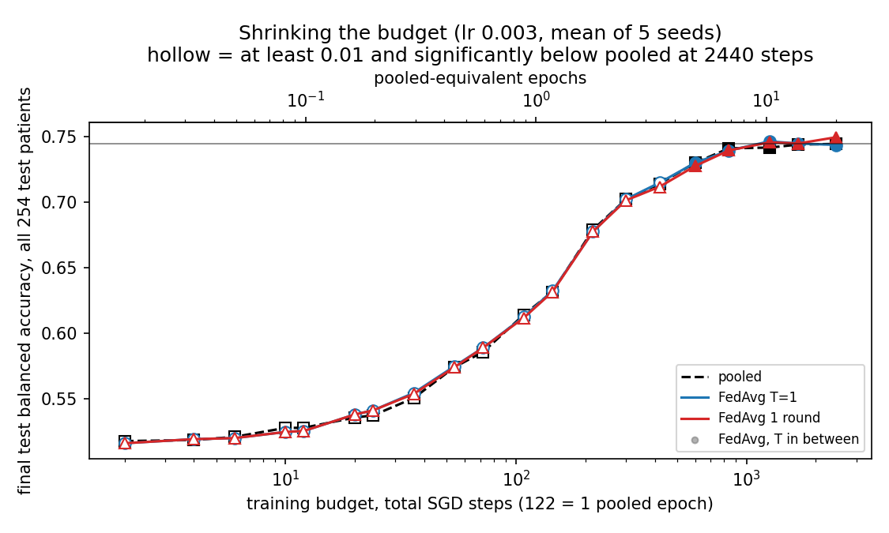
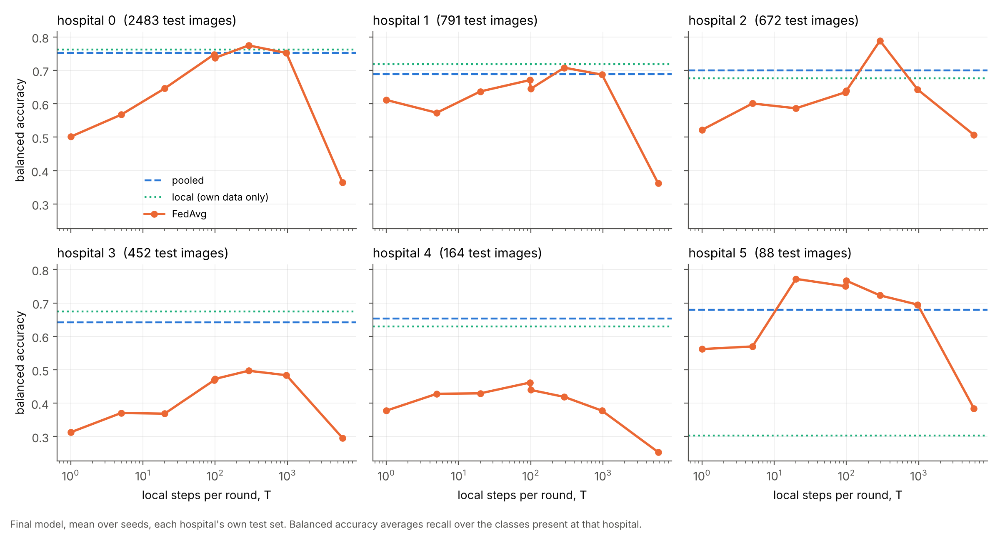

# Federated Learning on FLamby: Results Summary

How much does FedAvg lose against pooled training, and how does that depend on how often the hospitals communicate? Tested on two FLamby datasets: Fed-Heart-Disease (tabular, 4 hospitals) and Fed-ISIC2019 (skin lesion images, 6 hospitals).

## Contents

1. [Setup and notation](#setup-and-notation)
2. [What the FLamby paper did vs what I did](#what-the-flamby-paper-did-vs-what-i-did)
3. [Heart disease: communication rounds don't matter](#heart-disease-communication-rounds-dont-matter)
4. [ISIC: communication rounds matter a lot](#isic-communication-rounds-matter-a-lot)
5. [Which hospitals lose out](#which-hospitals-lose-out)
6. [Longer training on ISIC (40 epochs)](#longer-training-on-isic-40-epochs)
7. [Takeaways](#takeaways)
8. [Open questions and next steps](#open-questions-and-next-steps)

---

## Setup and notation

| | Fed-Heart-Disease | Fed-ISIC2019 |
|---|---|---|
| hospitals | 4 | 6 |
| data | 740 patients, 13 features, binary label | ~23k dermoscopy images, 8 classes |
| model | logistic regression (14 parameters) | EfficientNet-b0, ImageNet-pretrained (~4M parameters) |
| optimizer | SGD, lr 0.003 | Adam, lr 5e-4 |
| budget | 20 pooled epochs = 2440 SGD steps | 20 pooled epochs = 5820 steps |
| seeds | 5 | 3 |

Methods compared:

- **pooled**: one model trained on all hospitals' data in one place (the upper bound FL is trying to match)
- **local**: each hospital trains alone on its own data
- **FedAvg**: each hospital trains locally for **K steps**, the server averages the weights, repeat

**K** is local steps per round. Every run takes the same number of SGD steps as pooled, so the number of communication rounds is `budget / K`. K = 1 averages after every step; K = budget is a single round where each hospital trains alone and the server averages once at the end. (The figure files and some result tables still label K as "T", from before the rename.)

Every result reports three metrics, since accuracy alone hides a model that leans toward the common class:

- **accuracy**
- **balanced accuracy**: mean recall over classes (FLamby's metric for ISIC)
- **AUC**

Differences between methods come with 95% paired bootstrap intervals over the test patients/images.

---

## What the FLamby paper did vs what I did

FLamby (Ogier du Terrail et al., NeurIPS 2022 Datasets and Benchmarks) introduced these datasets and benchmarked a set of FL strategies against pooled and local training.

| | FLamby benchmark | This project |
|---|---|---|
| strategies | FedAvg, FedProx, SCAFFOLD, Cyclic, FedAdam, FedYogi, FedAdagrad | FedAvg only, studied in depth |
| local steps per round | fixed at 100 | swept from 1 step to a single round (7–12 values per dataset) |
| number of rounds | from budget formula: 15 (heart), 9 (ISIC) | matched to pooled's total steps: e.g. 59 rounds at K = 100 on ISIC |
| steps the global model gets (ISIC) | ~940: one client's share of the data × 20 epochs, 1/6 of pooled | 5820, same as pooled (each hospital does 6× less data per step than pooled sees, so FedAvg uses 6× pooled's total compute) |
| client optimizer | SGD, lr tuned per strategy | same optimizer and lr as pooled (SGD for heart, Adam for ISIC), so K is the only thing that changes |
| hyperparameter tuning | per strategy | on a held-out validation split, never on test (heart) |
| metrics | one per dataset (accuracy for heart, balanced accuracy for ISIC) | accuracy, balanced accuracy and AUC everywhere |
| uncertainty | mean over repeated runs | seed std plus paired bootstrap CIs over test patients |
| per-hospital view | yes | yes, plus per-class recall on ISIC |
| extra experiments | | heart: shrinking the training budget to 2 steps, lr × K grid; ISIC: 40-epoch rerun to check convergence |

FLamby answers "which FL strategy does best at one fixed setting". This project fixes the strategy and asks how the gap to pooled depends on communication frequency and training budget, with intervals tight enough to tell real gaps from noise.

---

## Heart disease: communication rounds don't matter

With every run taking 2440 steps, FedAvg matches pooled at every K, from 2440 rounds down to a single round.

| run | rounds | accuracy | balanced accuracy | AUC |
|---|---|---|---|---|
| pooled | – | 0.744 | 0.744 | 0.809 |
| FedAvg K = 1 | 2440 | 0.743 | 0.744 | 0.809 |
| FedAvg K = 122 | 20 | 0.744 | 0.744 | 0.809 |
| FedAvg K = 2440 | 1 | 0.749 | 0.749 | 0.810 |

Full table: [`fl-tabular/results/local_steps.md`](fl-tabular/results/local_steps.md)

This holds at smaller budgets too. Shrinking the budget from 2440 steps down to 2, FedAvg at every K tracks pooled at the same budget. Scores only start dropping below pooled-at-20-epochs once the budget falls under ~600 steps (about 5 epochs), and they drop identically for pooled and every FedAvg setting.

Full table: [`fl-tabular/results/budget_sweep.md`](fl-tabular/results/budget_sweep.md)

The lr × K grid ([`lr_T_grid.md`](fl-tabular/results/lr_T_grid.md)) shows the same: FedAvg never falls below pooled. At lr ≥ 0.3 FedAvg comes out ahead, because pooled itself degrades at high learning rates.

Why: a 14-parameter logistic regression on features scaled per hospital gives the hospitals very similar optima, so local drift between averages barely moves the result.

---

## ISIC: communication rounds matter a lot

On ISIC FedAvg is below pooled at every K, and the gap depends heavily on how often the hospitals average. Balanced accuracy on all 4650 test images:

| K | rounds | balanced accuracy | FedAvg − pooled [95% CI] |
|---|---|---|---|
| pooled | – | 0.748 | – |
| 1 | 5820 | 0.485 | −0.263 [−0.283, −0.243] |
| 5 | 1164 | 0.538 | −0.210 [−0.230, −0.191] |
| 20 | 291 | 0.609 | −0.139 [−0.158, −0.121] |
| 97 | 60 | 0.689 | −0.060 [−0.076, −0.044] |
| **291** | **20** | **0.714** | **−0.034 [−0.051, −0.018]** |
| 970 | 6 | 0.682 | −0.066 [−0.083, −0.049] |
| 5820 | 1 | 0.350 | −0.398 [−0.416, −0.379] |

Two things stand out:

- **The curve has a sweet spot at around 20 rounds (K = 291).** Too few rounds (6 or 1) lets each hospital drift toward its own label mix, and a single round collapses to 0.350.
- **More rounds also hurts, which is the opposite of what FedAvg theory predicts.** K = 1 should behave like pooled SGD with a larger batch, yet it scores 0.485. The likely cause is that every hospital starts a fresh Adam optimizer each round. With a fresh Adam, the first step is close to `lr × sign(gradient)`, so at K = 1 the model only ever takes those first steps and Adam's momentum and scaling never build up. Untested; see [next steps](#open-questions-and-next-steps).

Accuracy hides most of this: at K = 97–291 FedAvg's accuracy is statistically tied with pooled (0.768–0.780 vs 0.771) while balanced accuracy is 0.03–0.06 lower. At K = 100, FedAvg leans toward class 1 (nevus), the most common class and 84–94% of the images at hospitals 1 and 5. Its class-1 recall is 0.94 against pooled's 0.84, while it loses 6–19 points on melanoma, basal cell carcinoma, actinic keratosis and squamous cell carcinoma.

Full table: [`fl-isic/results/summary.md`](fl-isic/results/summary.md)

---

## Which hospitals lose out

- Hospitals 0, 1, 2 and 5 reach or beat pooled at their best K (K = 291 for 0–2).
- **Hospitals 3 and 4 stay well below both pooled and their own local model at every K.** They have the fewest nevus images (34% and 40% of their test sets) and the most even mix of other classes, so a global model pulled toward class 1 serves them worst.
- Hospital 5 (88 test images) is the one that gains most from FL: its local model scores 0.303, FedAvg reaches 0.76.

On heart disease the same pattern shows up in a milder form: overall FedAvg ties pooled, but Long Beach VA is significantly lower (accuracy −0.049, CI [−0.102, −0.009]).

---

## Longer training on ISIC (40 epochs)

At 20 epochs pooled was still improving, so pooled and FedAvg K = 100 were rerun at 40 epochs ([`fl-isic/results40/summary.md`](fl-isic/results40/summary.md)).

| run | balanced accuracy | accuracy | AUC |
|---|---|---|---|
| pooled, 40 epochs | 0.767 | 0.783 | 0.963 |
| FedAvg K = 100, 40 epochs | 0.686 | 0.800 | 0.956 |
| FedAvg − pooled [95% CI] | −0.081 [−0.099, −0.063] | +0.016 [+0.007, +0.026] | −0.008 [−0.012, −0.003] |

Pooled keeps improving (still rising at epoch 40 on all metrics, all 3 seeds). FedAvg's balanced accuracy is flat from 20 to 40 epochs, so the gap widens from −0.064 to −0.081 with more training. FedAvg is significantly ahead on plain accuracy, which comes from the same class-1 bias.

---

## Takeaways

- **Communication frequency only matters when hospitals differ.** On heart disease, a single round matches pooled. On ISIC, the number of rounds moves balanced accuracy from 0.35 to 0.71.
- **On ISIC there is a best K, around 20 rounds**, and both extremes are bad. The high-round side is likely an artifact of resetting Adam every round.
- **More training doesn't close the ISIC gap.** FedAvg plateaus while pooled keeps climbing.
- **Accuracy is misleading on ISIC.** FedAvg looks as good as or better than pooled on accuracy while losing on balanced accuracy, because it favors the majority class.
- **The overall score hides hospital-level losses.** Hospitals 3 and 4 on ISIC and Long Beach VA on heart disease are worse off under FedAvg even where the overall score holds.

---

## Open questions and next steps

- Test the Adam explanation: rerun the ISIC K sweep with each hospital's Adam state kept across rounds, or with SGD.
- Does pooled keep improving past 40 epochs on ISIC, and does the K sweep need a 40-epoch version?
- Add differential privacy (DP-SGD via Opacus; the `--dp` hook is in `fl-tabular`) and measure the privacy–accuracy trade-off, then compare correlated vs independent noise.
